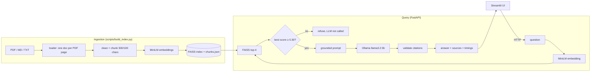

# AI Knowledge Assistant

**Ask questions about your own technical documents and get answers grounded only in
them, with a citation for every claim. When the documents don't contain the answer,
it says so. Runs entirely on your own computer: no API keys, no cloud, ₹0.**

[](https://github.com/pranavms04/AI_Engineering_Project/actions/workflows/ci.yml)


> Demo GIF: _placeholder (to be recorded)_. A real screen recording of the app is in
> [`site/assets/app-recording.mp4`](site/assets/app-recording.mp4), and the project page
> in [`site/`](site/README.md) walks through a real answer and its citation check.

## What it does

- **Answers from your documents only.** Add PDF, Markdown or text files; questions are
  answered from the most relevant passages, never from the model's general knowledge (by design; see Limitations).
- **Cites every claim** like `[fastapi-path-params.pdf, p. 2]`, and **checks every citation**
  against the passages the model was actually given. Citations to anything else are flagged.
- **Refuses instead of guessing.** If nothing in your documents is close enough to the
  question, it answers "I couldn't find this in the documents." without calling the model.
- **Private by construction.** Embeddings, search and the LLM all run locally
  (MiniLM, FAISS, Ollama). The API and UI listen on `127.0.0.1` only.
- **Measured, not claimed.** A 30-question evaluation with recorded config and results
  files; every number below comes from `evaluation/results/`.

## Architecture



| Layer | Code |
|---|---|
| Ingestion | `app/ingestion/` (pypdf loader, cleaning, chunking) |
| Retrieval | `app/retrieval/` (MiniLM embedder, FAISS vector store) |
| Generation | `app/generation/` (prompt, Ollama client, citation validation) |
| Service | `app/services/` (score gate, RAG answer, index rebuild) |
| API | `app/api/` (FastAPI: `/health`, `/ask`, `/documents`, `/index/rebuild`) |
| UI | `ui/streamlit_app.py` (talks to the API over HTTP only) |
| Evaluation | `evaluation/` (dataset, metrics, runner, results) |

## Quickstart (local)

You need Python 3.11 and [Ollama](https://ollama.com).

```bash
git clone https://github.com/pranavms04/AI_Engineering_Project.git
cd AI_Engineering_Project
python3.11 -m venv .venv && source .venv/bin/activate
pip install -r requirements.txt
ollama pull llama3.2:3b
```

Put your `.pdf`, `.md` or `.txt` files in `data/sample_docs/` (git-ignored), then:

```bash
python -m scripts.build_index              # build the search index
ollama serve                               # terminal 1
uvicorn app.api.main:app                   # terminal 2: API on 127.0.0.1:8000 (/docs for the API page)
streamlit run ui/streamlit_app.py          # terminal 3: UI on http://localhost:8501
```

Or from the terminal only: `python -m scripts.ask "your question"`.

## Quickstart (Docker)

API and UI run in containers; **Ollama runs on the host** (Docker on a Mac cannot use the
Apple GPU, so a containerised Ollama would be much slower). Your documents and index are
mounted from `data/` and `storage/`, not copied into the image.

```bash
ollama serve                               # on the host, first
docker compose up --build                  # Homebrew/Colima: docker-compose up --build
```

Then open http://localhost:8501. Details and troubleshooting: [`docs/RUNBOOK.md`](docs/RUNBOOK.md).

## Example (real output)

Recorded from the real pipeline on 2026-10-25 (`site/data/recorded.json`):

```text
Q: How do I declare a path parameter with a type?
A: You can declare the type of a path parameter in the function, using standard
   Python type annotations: [fastapi-path-params.pdf, p. 2].
   WARNING invalid citations: [fastapi-path-params.pdf, p. 2]
   Retrieved: p. 6 (0.555), p. 1 (0.470), p. 12 (0.468), p. 12 (0.439)

Q: What is the capital of France?
A: I couldn't find this in the documents.
   (best match 0.120 < threshold 0.30, model not called)
```

The first answer is correct, but the model wrote the wrong page: the sentence is word for
word on p. 1. The citation check catches it. This is the most repeatable mistake in the
evaluation, and why answers show their sources.

## Evaluation

30 questions written from one 13-page FastAPI PDF: 24 answerable (including paraphrases and
multi-page questions) and 6 that should be refused. Config: chunks 500/100, top 4,
threshold 0.30, all-MiniLM-L6-v2, llama3.2:3b, prompt v1, temperature 0.1. Full method and
per-run tables: [`evaluation/README.md`](evaluation/README.md).

**Retrieval** (deterministic, `20261025-221343-retrieval-c500o100.json`):

| Recall@1 | Recall@3 | Recall@4 | Recall@10 | MRR@10 |
|---|---|---|---|---|
| 0.667 | 0.917 | 0.958 (23 of 24) | 1.000 | 0.803 |

**Chunk-size experiment** (retrieval only): 300/100 → Recall@4 0.875; **500/100 → 0.958**;
800/150 → 0.917. Kept 500/100.

**Full answers**, three runs after the Phase 9 bug fixes
(`20261025-230001`, `-230404`, `-230830`):

| Metric | Run 1 | Run 2 | Run 3 |
|---|---|---|---|
| Citation accuracy (valid / all citations) | 0.870 | 0.905 | 0.895 |
| Answers with a citation to a page it wasn't given | 3 | 2 | 2 |
| Should-refuse questions refused (of 6) | 5 | 5 | 5 |
| Answerable questions wrongly refused (of 24) | 3 | 4 | 3 |
| Keyword coverage (rough proxy) | 0.736 | 0.694 | 0.736 |

Median time to a full answer in the three baseline runs (same settings, quieter machine):
2.6 s, 3.4 s and 4.9 s on an 8 GB M1 laptop.

**What the numbers say:** retrieval is strong; most errors come from the 3B model:
wrong page numbers, two answerable paraphrases refused by the score gate, and one
should-refuse question (Docker) answered from the model's own knowledge. Results are
indicative: one PDF, 30 questions, one annotator.

**Bugs the evaluation found (and how they were fixed):** an invented answer that ended with
the refusal sentence counted as a refusal, and code like `return [user.value]` was read as
a citation. Both are fixed, tested and re-measured: see the follow-up section in
[`evaluation/README.md`](evaluation/README.md).

## Design choices and trade-offs

| Decision | Why | Trade-off / alternative |
|---|---|---|
| Build RAG by hand first | Understand every step before abstractions | LangChain is faster to write, hides details |
| One Document per PDF page | Page-level citations | Long pages need chunking anyway |
| 500 chars / 100 overlap | One idea per chunk, under MiniLM's 256-token limit | Chosen by experiment (above) |
| all-MiniLM-L6-v2 | Small, CPU-friendly, Apache-2.0 | Weaker than newer models; swapping is a measured experiment |
| FAISS IndexFlatIP | Exact search, cosine via normalized vectors, trivial at this scale | HNSW/IVF for millions; Chroma/pgvector for a DB |
| JSON not pickle | Pickle can execute code on load | Slightly larger files |
| Ollama local LLM | Free, private, offline | Slower and weaker than hosted models |
| Score threshold + refusal | Reduces hallucination when retrieval is weak | No threshold separates all cases (measured) |
| Citation validation | Model can invent sources; checked against retrieved chunks | Doesn't prove the claim is correct |
| Mock LLM in tests | Fast, deterministic, CI doesn't need Ollama | Real-model behaviour checked by evaluation |
| Streamlit calls the API | Clean separation; UI is replaceable (e.g. Flutter) | Two processes to run |

## Testing

```bash
python -m pytest -q        # 123 tests, no Ollama needed (the LLM is mocked)
```

Tests cover loading, cleaning, chunking, embeddings (real MiniLM), the vector store,
prompts and citations, the RAG service, every API endpoint (including upload attacks),
the UI's HTTP layer, and the evaluation metrics. GitHub Actions runs them on every push.

## Security and privacy

- Documents (`data/sample_docs/`) and the index (`storage/`) are git-ignored and never leave your machine.
- API and UI bind to `127.0.0.1`; Docker publishes ports on `127.0.0.1` only. There is no
  authentication, so do not expose them to a network.
- Uploads: `.pdf/.md/.txt` only, 10 MB limit, filenames stripped of folders (`../../x.md` → `x.md`).
- Retrieved text is passed to the model as delimited data with an instruction to ignore
  instructions inside it; the UI strips Markdown images from answers so a prompt-injected
  answer cannot make the browser call another site.
- Index metadata is JSON, not pickle. No API keys or secrets exist in this project.

## Limitations

- A 3B local model makes real mistakes: wrong page numbers, an invented answer for a
  near-topic question, and one wrong claim with a valid citation. Citations show where a
  sentence points, not that it is true.
- Evaluation is small (one PDF, 30 questions, one annotator) and LLM runs vary.
- No OCR (scanned PDFs are skipped), no authentication, synchronous index rebuild,
  English-only testing.

## Future work

A prompt v2 that stops the model copying the example page number; a faithfulness check;
hybrid search (BM25 + vectors) or a reranker, measured against this evaluation; streaming
answers; a Flutter client over the same API.

## Project structure

```text
app/            ingestion, retrieval, generation, services, api
ui/             Streamlit UI (HTTP client of the API)
scripts/        build_index, search, ask
evaluation/     dataset, metrics, run_eval, rescore, results/
tests/          pytest suite (123 tests)
site/           static project page (real recorded data)
docs/           spec, progress log, runbook, learning notes per phase
```

## Licence

Code: [MIT](LICENSE). Models are downloaded separately and keep their own licences:
all-MiniLM-L6-v2 (Apache-2.0); Llama 3.2 via Ollama (Llama 3.2 Community License, Meta).
The project page uses the scroll-craft engine (MIT) and Geist fonts (SIL OFL); see `site/README.md`.
