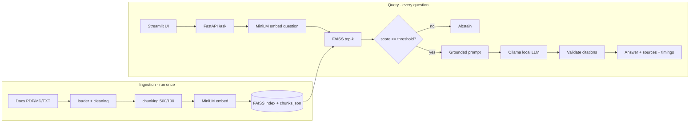

# Project Spec — AI Knowledge Assistant for Technical Documents

## 1. Purpose

Teams keep knowledge in PDFs, manuals, API docs and wikis. People waste time
searching by keyword or asking colleagues. General chatbots don't know private
documents, make things up, and often can't be given confidential files.

This app answers questions **from your own documents only**, shows **which
file and page** each claim came from, and **runs entirely on your machine** —
no data leaves it and nothing costs money.

Example use: point it at the FastAPI, Flutter and Python docs and ask
"How do I declare a typed path parameter?" → answer + `[fastapi-path-params.pdf, p. 2]`.

Honest positioning: a portfolio project demonstrating the full RAG pattern
end-to-end (ingest → retrieve → generate → serve → evaluate → ship). Not a
commercial product; no real users.

## 2. Functional requirements

| ID | Requirement | Phase |
|---|---|---|
| F1 | Load PDF (per page), MD, TXT; skip empty/corrupt/duplicate files with warnings | done |
| F2 | Clean extracted text; chunk with overlap; keep source/page metadata | done |
| F3 | Embed chunks locally; persist a FAISS index + JSON chunk store | done |
| F4 | Retrieve top-k chunks for a question | done |
| F5 | Generate an answer with a local LLM using only retrieved chunks | 6 |
| F6 | Cite sources `[file, p. N]`; citations must refer to retrieved chunks | 6 |
| F7 | Abstain ("I couldn't find this in the documents") when evidence is weak | 6 |
| F8 | REST API: health, ask, list documents, upload document, rebuild index | 7 |
| F9 | Web UI: chat box, answer, expandable sources with scores, upload | 8 |
| F10 | Evaluation set + script: Recall@k, MRR, citation accuracy, abstention, latency | 9 |
| F11 | One-command run (docker compose), CI tests on every push, README | 10 |

## 3. Non-functional requirements

- **Cost:** ₹0. Local only. No API keys.
- **Privacy:** documents and index never committed or sent anywhere.
- **Reliability:** clear errors; Ollama-down is handled gracefully (HTTP 503 in API).
- **Testability:** unit tests for every module; LLM mocked in tests; CI green.
- **Honesty:** all reported numbers come from `evaluation/results/*.json`.
- **Simplicity:** plain Python pipeline; frameworks only for comparison.

## 4. Target architecture



## 5. Target directory layout

```
ai-knowledge-assistant/
├── CLAUDE.md
├── app/
│   ├── config.py                 # Phase 6: settings from env
│   ├── ingestion/                # done: loader, cleaning, chunking
│   ├── retrieval/                # done: embedder, vector_store
│   ├── generation/               # Phase 6
│   │   ├── llm_client.py         #   Ollama HTTP client (+ protocol for mocking)
│   │   ├── prompts.py            #   versioned prompt templates
│   │   └── citations.py          #   parse + validate [file, p. N]
│   ├── services/
│   │   └── rag_service.py        # Phase 6: retrieve → gate → prompt → LLM → validate
│   └── api/                      # Phase 7
│       ├── main.py
│       ├── schemas.py
│       └── dependencies.py
├── ui/streamlit_app.py           # Phase 8
├── evaluation/                   # Phase 9
│   ├── dataset.jsonl
│   ├── run_eval.py
│   └── results/
├── scripts/                      # build_index, search, ask, playground
├── tests/
├── docs/                         # spec, progress, phase prompts, learning notes
├── data/sample_docs/             # git-ignored
├── storage/                      # git-ignored
├── .env.example  .gitignore  requirements.txt  pytest.ini
├── Dockerfile  docker-compose.yml  .github/workflows/ci.yml   # Phase 10
├── README.md  LICENSE
```

## 6. Key design decisions (and why) — interview material

| Decision | Why | Trade-off / alternative |
|---|---|---|
| Build RAG by hand first | Understand every step before abstractions | LangChain is faster to write, hides details |
| One Document per PDF page | Page-level citations | Long pages need chunking anyway |
| 500 chars / 100 overlap | One idea per chunk, under MiniLM's 256-token limit | Tune with evaluation, don't guess |
| all-MiniLM-L6-v2 | Small, CPU-friendly, Apache-2.0 | Weaker than newer models; swap is a measured experiment |
| FAISS IndexFlatIP | Exact search, cosine via normalized vectors, trivial at this scale | HNSW/IVF for millions; Chroma/pgvector for a DB |
| JSON not pickle | Pickle can execute code on load | Slightly larger files |
| Ollama local LLM | Free, private, offline | Slower and weaker than hosted models |
| Score threshold + abstain | Reduces hallucination when retrieval is weak | Threshold must be tuned on the eval set |
| Citation validation | Model can invent sources; we check against retrieved chunks | Doesn't prove the claim is correct |
| Mock LLM in tests | Fast, deterministic, CI doesn't need Ollama | Real-model behaviour checked by evaluation |
| Streamlit calls the API | Clean separation; UI is replaceable (e.g. Flutter) | Two processes to run |

## 7. Out of scope (unless asked later)

Authentication/multi-user, cloud deployment, fine-tuning, OCR for scanned PDFs,
multi-agent systems, Kubernetes. Mention them as "future work" in the README.

## 8. Optional extensions (after Phase 10, only if asked)

- Framework comparison: same pipeline in LangChain, compare code + eval results.
- Hybrid search (BM25 + vectors) and/or a cross-encoder reranker, measured.
- Conversation memory (follow-up questions).
- A single tool-calling agent feature with human approval.
- Flutter client app over the FastAPI backend.
