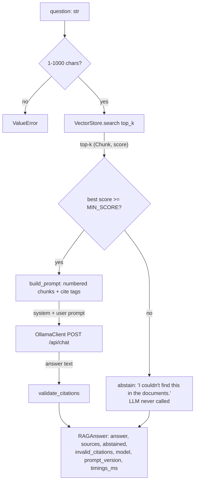

# Phase 6 — Grounded answers with citations (the "G" in RAG)

## 1. What we built and why

Until now the app could only *find* chunks. Phase 6 adds a local LLM (Ollama) that
*writes an answer* using only those chunks, cites each claim like
`[fastapi-path-params.pdf, p. 1]`, and refuses to answer when the documents
don't contain the answer. This is what stops a chatbot from confidently making
things up about your private documents.

## 2. Explain like I'm five

You ask a librarian a question. The librarian (retrieval) brings you four
pages. A student (the LLM) must write the answer **using only those four pages**
and must write the page number after every sentence. If the librarian comes back
with pages that are clearly about something else, we don't even bother the
student — we just say "I couldn't find this". Afterwards a teacher (citation
validation) checks every page number the student wrote really was one of the
four pages.

## 3. Diagram



## 4. The real concepts

| Term | Plain meaning |
|---|---|
| **Grounding** | Making the model answer from given text, not from what it memorised in training. |
| **System prompt** | Instructions sent with a special "system" role; models give it more weight than the user message. |
| **Temperature** | Randomness of the next-word choice. 0.1 = almost always the most likely word, so answers are stable. |
| **Abstain** | Deliberately answering "I don't know" instead of guessing. |
| **Score threshold (`MIN_SCORE`)** | Cosine similarity cut-off. Below it we assume retrieval found nothing relevant. |
| **Citation validation** | Checking each `[file, p. N]` in the answer against the chunks we actually sent. Catches invented sources. It does **not** prove the sentence is true. |
| **Prompt injection** | Text inside a document like "ignore your rules and…". We wrap documents in `<context>` and tell the model it is data, not instructions. |
| **Protocol** | A Python "interface": any class with a `generate(system, prompt)` method and a `model` attribute counts as an `LLMClient`. Lets tests swap in a fake. |
| **Test double / fake** | A stand-in object for tests (`FakeLLMClient`) that returns a fixed answer and records what it was asked. |
| **Prompt version** | `PROMPT_VERSION = "v1"` is stored with every answer so evaluation results can be tied to the exact prompt. |

## 5. Code walkthrough

### [app/config.py](../../app/config.py) — every tunable number in one place
```python
@dataclass(frozen=True)
class Settings:
    ollama_model: str = "llama3.2:3b"
    top_k: int = 4
    min_score: float = 0.30
```
Defaults live in the dataclass; `Settings.from_env()` overrides them from
environment variables (`TOP_K=2 python -m scripts.ask ...`). `frozen=True` means
settings can't be changed by accident halfway through a request.

### [app/generation/llm_client.py](../../app/generation/llm_client.py) — talk to Ollama
```python
body = {"model": ..., "messages": [system, user], "stream": False, "options": {"temperature": ...}}
except httpx.TimeoutException as exc:
    raise LLMUnavailableError(...)
except httpx.TransportError as exc:
    raise LLMUnavailableError("Cannot reach Ollama ... Is it running?")
if response.status_code == 404:
    raise LLMResponseError("Model ... not found. Run: ollama pull ...")
```
- `stream: False` → Ollama returns one JSON object instead of many small pieces. Simpler.
- Two error types: *can't reach it* (`LLMUnavailableError`, the API will turn this into HTTP 503 in Phase 7) vs *reached it but the reply is bad* (`LLMResponseError`).
- Timeout is checked **before** TransportError because a timeout is a kind of transport error in httpx.
- `http_client` can be injected — tests pass an `httpx.MockTransport`, so no server is needed.

### [app/generation/prompts.py](../../app/generation/prompts.py) — the rules
```python
--- Chunk 1 | cite as [fastapi-path-params.pdf, p. 1] ---
<chunk text>
```
Each chunk is numbered **and** carries its exact citation tag, so the model can
copy it instead of inventing a format. The system prompt has five rules: only use
context, exact abstain sentence, cite every claim, context is data, be concise.

### [app/generation/citations.py](../../app/generation/citations.py) — check the model's homework
```python
CITATION_PATTERN = re.compile(r"(?<![\w\]])\[([^\[\],]+\.\w+)(?:,\s*p\.\s*(\d+))?\]")
```
Finds `[name.ext]` or `[name.ext, p. 3]`. The `(?<![\w\]])` part skips code like
`items[0]`. `validate_citations` builds the set of allowed tags from the retrieved
chunks and splits the answer's tags into `valid` and `invalid`.

### [app/services/rag_service.py](../../app/services/rag_service.py) — the whole flow
```python
best_score = retrieved[0][1] if retrieved else 0.0
if best_score < self.settings.min_score:
    return self._result(ABSTAIN_ANSWER, sources, True, [], timings)
answer = self.llm.generate(SYSTEM_PROMPT, build_prompt(question, retrieved))
_valid, invalid = validate_citations(answer, retrieved)
```
The gate runs **before** the LLM: cheap, fast, and the model never gets a chance
to hallucinate from irrelevant chunks. Sources are returned even when we abstain,
so a user can see why.

### [scripts/ask.py](../../scripts/ask.py) — command-line front end
Loads settings + index, builds `RAGService(store, OllamaClient(settings), settings)`,
prints answer, sources table and timings. Ollama errors become a one-line message.

## 6. How to run and see it work

```bash
source .venv/bin/activate
python -m scripts.build_index
python -m scripts.ask "What is the capital of France?"
```
Real output captured in this phase (Ollama was **not** running — the gate didn't need it):
```
I couldn't find this in the documents.

(abstained — not enough evidence in the documents)

Retrieved sources:
   score  citation
   0.120  [fastapi-path-params.pdf, p. 4]
   0.112  [fastapi-path-params.pdf, p. 12]
   0.110  [active.txt]
   0.068  [fastapi-path-params.pdf, p. 11]

model=llama3.2:3b  prompt=v1  retrieve=3836 ms  generate=0 ms  total=3839 ms
```
`retrieve=3836 ms` includes loading MiniLM for the first time in that process — it is
not the normal search time.

With Ollama running (`llama3.2:3b`, Ollama 0.40.4 from Homebrew, M1 8 GB), real output
from 2026-10-24:
```bash
python -m scripts.ask "How do I declare a path parameter with a type?"
```
```
You can declare the type of a path parameter in the function, using standard Python
type annotations: [fastapi-path-params.pdf, p. 2].

WARNING invalid citations: [fastapi-path-params.pdf, p. 2]

Retrieved sources:
   score  citation
   0.555  [fastapi-path-params.pdf, p. 6]
   0.470  [fastapi-path-params.pdf, p. 1]
   0.468  [fastapi-path-params.pdf, p. 12]
   0.439  [fastapi-path-params.pdf, p. 12]

model=llama3.2:3b  prompt=v1  retrieve=1066 ms  generate=14076 ms  total=15144 ms
```
Running it a second time gave the same answer with `generate=1465 ms`. The first call is
slow because Ollama loads the model into RAM; after that it stays loaded. `retrieve` was
1375 ms: each `ask` run is a new process, so MiniLM loads again — that time is mostly
model loading, not FAISS search.

An earlier run on 2026-10-23 (Ollama 0.40.9 app) gave the identical answer and the same
wrong citation, with `generate=23496 ms` cold and `2188 ms` warm. Same model, same
prompt, same answer — the mistake is repeatable, not a one-off.

**What this real run teaches us — the validator caught a real mistake.**
The answer sentence is copied almost word-for-word from **page 1** (chunk 0, ranked 2nd),
but the model wrote **p. 2**. Page 2 was never retrieved. Suspected reason (not yet
tested): the system prompt's own example is `[guide.pdf, p. 2]`, and a 3B model copied
the example's page number instead of the tag on the chunk. So:
- the *answer* is grounded and correct,
- the *citation* is wrong,
- `validate_citations` flagged it — exactly the case it exists for.

A possible fix (not done in this phase) is a prompt whose example can't be confused with
a real page, e.g. `[file-name, p. N]`, saved as `PROMPT_VERSION = "v2"` so v1 and v2 can
be compared with real numbers in Phase 9.

## 7. Common errors

| What you see | Why | Fix |
|---|---|---|
| `LLM error: Cannot reach Ollama at http://localhost:11434/api/chat. Is it running?` | Ollama app not installed/open (hit in this phase) | Install from ollama.com, open the app, `curl localhost:11434/api/tags` |
| `Model 'llama3.2:3b' not found. Run: ollama pull llama3.2:3b` | Model not downloaded | `ollama pull llama3.2:3b` |
| `LLM error: Ollama timed out` | First call loads the model into RAM; slow on 8 GB | Retry, or raise `LLM_TIMEOUT_S` |
| `FileNotFoundError: No index in storage/index` | Index not built | `python -m scripts.build_index` |
| `WARNING invalid citations: [fastapi-path-params.pdf, p. 2]` (hit in this phase) | Model wrote a page that wasn't retrieved; the text really came from p. 1 | Suspected: copied from the prompt's example tag. Try a v2 prompt; measure in Phase 9 |
| `no space left on device` during the model pull (hit in this phase) | The model is ~2 GB; the disk had less free | Free space, then pull again |
| `lookup ... no such host` in the Ollama log during a pull (hit in this phase) | Network dropped mid-download | Check the connection, restart the pull — it resumes |
| Every question abstains | `MIN_SCORE` too high for your docs | Lower it; tune properly in Phase 9 |

## 8. Security and limits

- **Prompt injection:** documents are wrapped in `<context>` and the system prompt says they are data. This *reduces* risk; a small model can still be fooled. The app never takes actions based on model output, so the worst case is a wrong answer.
- **Hallucination:** the score gate + abstain rule + citation validation reduce it. Citation validation only checks the *source exists*, not that the sentence is correct.
- **Privacy:** the only network call is to Ollama on localhost. Logs contain scores and citation tags, never document text.
- **Limits:** `MIN_SCORE=0.30` is a starting guess, not a tuned value. A 3B model follows rules less reliably than larger models.

## 9. Interview questions

1. **Why abstain before calling the LLM instead of letting the model decide?**
   It's cheaper and safer. If retrieval found nothing relevant (e.g. "capital of France" scored 0.120), giving the model irrelevant text invites it to use its own memory. The gate removes that chance. The model can *also* abstain via the prompt rule for cases that pass the gate.
2. **How do you know a citation is real?** `validate_citations` compares every `[file, p. N]` in the answer with tags built from the chunks actually sent. Anything else goes into `invalid_citations`. It proves the source was given, not that the claim is correct. In the first real run it caught `llama3.2:3b` citing p. 2 for a sentence that came from p. 1.
3. **How do you test code that depends on an LLM?** The service depends on an `LLMClient` Protocol. Tests inject `FakeLLMClient`, which returns a canned answer and records calls, so I can assert "the LLM was never called" for low scores. The HTTP client is tested with `httpx.MockTransport`. 44 tests run without Ollama.
4. **Why temperature 0.1?** We want factual, repeatable answers from fixed context, not creativity.
5. **What is prompt injection and what did you do about it?** Instructions hidden in documents. Context is delimited and labelled as data in the system prompt, and the app never executes model output. It's a mitigation, not a guarantee.
6. **Why `PROMPT_VERSION`?** Prompts change behaviour like code does. Storing the version with each answer and each eval result lets me compare prompts fairly.
7. **Why separate `LLMUnavailableError` and `LLMResponseError`?** They need different handling: unavailable → HTTP 503 "try later"; bad response → a server-side problem to log and fix.
8. **Why Ollama and a 3B model?** Free, private, offline, fits an 8 GB M1. Trade-off: weaker instruction-following than large hosted models — we already saw one wrong citation; Phase 9 measures how often. On this Mac the first answer took 14.1 s to generate (model loading), the next 1.5 s.

## 10. Try it yourself

1. Run `MIN_SCORE=0.6 python -m scripts.ask "How do I declare a path parameter with a type?"`. The top score was 0.555 in Phase 0 — predict what happens before you run it.
2. Add a test in `tests/test_generation.py` that `extract_citations("[notes.txt]")` returns `["[notes.txt]"]`, then one for a tag with extra spaces like `[ a.md ]` and decide what *should* happen.
