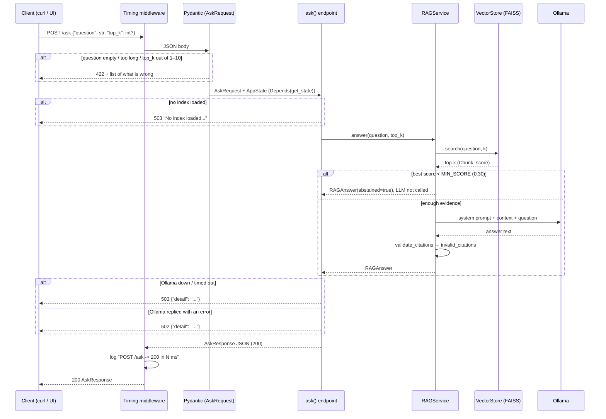
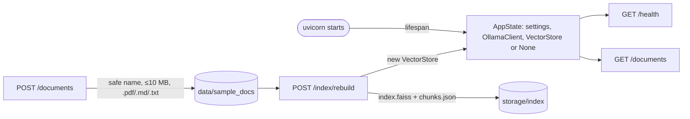

# Phase 7 — FastAPI backend

## 1. What we built and why

Until Phase 6 the assistant only worked from the terminal (`python -m scripts.ask`).
Phase 7 puts the same `RAGService` behind an HTTP API, so any program — the Streamlit
UI in Phase 8, `curl`, or a mobile app — can ask questions, upload documents and rebuild
the index. The API loads the index and the LLM client **once** at startup, checks every
input with Pydantic, and turns failures into clear HTTP status codes instead of crashes.

## 2. Explain like I'm five

The API is a **restaurant counter**.
- The **menu** is `/docs`: it lists what you can order and how.
- The **waiter** (Pydantic) checks your order before it reaches the kitchen. "A blank
  order? No." (422)
- The **kitchen** is `RAGService` + Ollama. It was set up once in the morning (lifespan),
  not every time someone orders.
- If the chef is missing, the waiter says "kitchen closed" (503) instead of serving nothing.
- The **delivery door** (`POST /documents`) only accepts boxes labelled .pdf, .md or .txt,
  under 10 MB, and always puts them on the same shelf (`DOCS_DIR`), whatever address is
  written on the box.

## 3. Diagram

What happens during `POST /ask`:



Startup and the other endpoints:



## 4. The real concepts

| Term | Plain meaning |
|---|---|
| **REST API** | A program other programs talk to over HTTP, using URLs (`/ask`) and methods (GET reads, POST sends or changes). |
| **Endpoint** | One URL + method, handled by one Python function, e.g. `POST /ask` → `ask()`. |
| **Status code** | A 3-digit number saying how the request went: 200 OK, 201 created, 4xx "your request is wrong", 5xx "the server or something behind it failed". |
| **Pydantic model** | A class that describes the shape of data. FastAPI uses it to check incoming JSON and to build outgoing JSON. Bad input → 422 automatically. |
| **Dependency injection (`Depends`)** | The endpoint says "I need the AppState"; FastAPI hands it over. Tests can hand over a fake one instead, with `app.dependency_overrides`. |
| **Lifespan** | Code that runs once when the server starts (and once when it stops). We load the index and create the Ollama client there. |
| **Middleware** | Code that wraps **every** request. Ours measures how long each request took and logs it. |
| **CORS** | A browser rule: a web page from one origin (e.g. `localhost:8501`) may call another origin only if that server allows it. We allow only the Streamlit UI. |
| **Multipart upload** | The HTTP format for sending files. FastAPI needs `python-multipart` to read it. |
| **Path traversal** | An attack where a filename like `../../x.md` tries to escape the upload folder. |
| **Synchronous endpoint** | The client waits until the work is done. `/index/rebuild` is synchronous — fine for a demo, slow for big document sets. |
| **TestClient** | Lets tests call the API in memory, without starting a real server. |

## 5. Code walkthrough

### [app/api/schemas.py](../../app/api/schemas.py) — the shape of every request and response

```python
Question = Annotated[str, StringConstraints(strip_whitespace=True, min_length=1, max_length=MAX_QUESTION_CHARS)]

class AskRequest(BaseModel):
    question: Question
    top_k: int | None = Field(default=None, ge=1, le=MAX_TOP_K)
```
- `strip_whitespace=True` runs **before** `min_length`, so `"   "` becomes `""` and is rejected with 422.
- `max_length` reuses `MAX_QUESTION_CHARS` (1000) from `rag_service.py`, so the limit lives in one place.
- `ge=1, le=10` means 1 ≤ top_k ≤ 10. `None` means "use TOP_K from settings".

`AskResponse` has the same fields as the `RAGAnswer` dataclass, so `main.py` can build it with
`AskResponse.model_validate(asdict(result))`.

### [app/api/dependencies.py](../../app/api/dependencies.py) — load things once, share them

```python
@dataclass
class AppState:
    settings: Settings
    llm: LLMClient
    store: VectorStore | None
    rebuild_lock: threading.Lock = field(default_factory=threading.Lock)
```
- One object holds everything the endpoints share.
- `store` can be `None`: the API still starts without an index; `/health` says so and `/ask` returns 503.

```python
@asynccontextmanager
async def lifespan(app: FastAPI):
    app.state.rag = create_state(Settings.from_env())
    yield

def get_state(request: Request) -> AppState:
    return request.app.state.rag
```
- `lifespan` runs once at startup. Code before `yield` = startup.
- Endpoints never build their own state; they ask for `Depends(get_state)`.
- Tests replace `get_state` with a lambda returning a fake state — that is the whole reason this function exists.

### [app/api/uploads.py](../../app/api/uploads.py) — rules for uploaded files

```python
name = Path((raw_name or "").replace("\\", "/")).name.strip()
if not name or name.startswith("."):
    raise UploadError(400, ...)
if Path(name).suffix.lower() not in ALLOWED_EXTENSIONS:
    raise UploadError(415, ...)
```
- `Path(...).name` keeps only the last part: `../../x.md` → `x.md`, `/etc/x.md` → `x.md`.
- Backslashes are turned into `/` first, so the Windows form `..\..\x.md` is handled too.
- Names starting with `.` are refused (hidden files like `.env.md`, or `..`).

```python
target = (docs_dir / name).resolve()
if target.parent != docs_dir.resolve():
    raise UploadError(400, ...)
if target.exists():
    raise UploadError(409, ...)
```
- A second check after resolving the real path ("defence in depth").
- 409 instead of silently overwriting a document you already have.

### [app/api/main.py](../../app/api/main.py) — the endpoints

```python
@app.middleware("http")
async def log_timing(request: Request, call_next):
    start = time.perf_counter()
    response = await call_next(request)
    logger.info("%s %s -> %d in %.1f ms", request.method, request.url.path, response.status_code, ms)
```
- Wraps every request and logs one line, e.g. `POST /ask -> 200 in 2660.0 ms`.

```python
try:
    result = service.answer(request.question, top_k=request.top_k)
except LLMUnavailableError as exc:
    raise HTTPException(503, str(exc))
except LLMResponseError as exc:
    raise HTTPException(502, str(exc))
```
- Phase 6 errors become HTTP codes: 503 = "Ollama is not there", 502 = "Ollama answered badly" (e.g. model not pulled).

```python
content = await file.read(max_bytes + 1)
check_size(content, max_bytes)
```
- Read at most one byte more than allowed. If that extra byte arrives, the file is too big → 413.

```python
if not state.rebuild_lock.acquire(blocking=False):
    raise HTTPException(409, "A rebuild is already running. Try again shortly.")
...
state.store = store
```
- Only one rebuild at a time. `/ask` keeps using the old store until the new one is ready, then one assignment swaps it.

### [app/services/indexing.py](../../app/services/indexing.py) — one rebuild function for script and API

```python
def rebuild_index(docs_dir, index_dir, chunk_size=500, overlap=100) -> tuple[VectorStore, IndexStats]:
    if not docs_dir.is_dir():
        raise ValueError(...)
    docs = load_directory(docs_dir)
    chunks = chunk_documents(docs, chunk_size, overlap)
```
- `scripts/build_index.py` and `POST /index/rebuild` both call this, so they can never drift apart.
- The `is_dir()` check was added after a test found a bug (see section 7).

### Small addition: `is_reachable()` in [llm_client.py](../../app/generation/llm_client.py)
`GET /api/tags` with a 2-second timeout. Returns `True`/`False`, never raises — `/health` must always answer.

## 6. How to run and see it work

```bash
ollama serve                                  # terminal 1
uvicorn app.api.main:app --reload             # terminal 2 (from repo root, .venv active)
```
Open `http://localhost:8000/docs` for the interactive menu of endpoints.

Real output from 2026-10-25 (M1 8 GB, llama3.2:3b):

```bash
curl -s localhost:8000/health
```
```json
{"status":"ok","index_loaded":true,"chunks":35,"llm_reachable":true,"model":"llama3.2:3b"}
```

```bash
curl -s -X POST localhost:8000/ask -H 'Content-Type: application/json' \
  -d '{"question":"How do I declare a path parameter with a type?"}'
```
```json
{
  "answer": "You can declare the type of a path parameter in the function, using standard Python type annotations: [fastapi-path-params.pdf, p. 2].",
  "sources": [ {"citation": "[fastapi-path-params.pdf, p. 6]", "score": 0.5548, ...}, ... ],
  "abstained": false,
  "invalid_citations": ["[fastapi-path-params.pdf, p. 2]"],
  "prompt_version": "v1",
  "model": "llama3.2:3b",
  "timings_ms": {"retrieve": 638.7, "generate": 2009.1, "total": 2649.4}
}
```
Same answer and same wrong citation as in Phase 6 — the API changes the door, not the kitchen.

"What is the capital of France?" → `"abstained": true`, `generate: 0.0`, total 134.8 ms.

Timing log lines from the server (real):
```
INFO app.api.main: POST /ask -> 200 in 12482.1 ms   <- first request: Ollama + MiniLM loading
INFO app.api.main: POST /ask -> 200 in 2660.0 ms
INFO app.api.main: POST /ask -> 200 in 136.5 ms     <- abstained, no LLM call
INFO app.api.main: POST /ask -> 422 in 6.8 ms
```
Because the server keeps MiniLM loaded, `retrieve` dropped to 135–165 ms after warm-up,
versus about 1.1–1.4 s per run in the CLI (which reloads the model every time).

Upload → rebuild → ask, with an invented test note (deleted afterwards):
```
POST /documents  wifi-notes.md, filename sent as "../../wifi-notes.md"
  → 201 {"filename":"wifi-notes.md","bytes":141,...}   (saved inside data/sample_docs only)
POST /documents  same file again        → 409 already exists
POST /documents  tool.exe               → 415 File type not allowed
POST /index/rebuild → {"documents":15,"chunks":36,"sources":[...,"wifi-notes.md"],"seconds":2.22}
POST /ask "What is the guest Wi-Fi network called?"
  → "The guest Wi-Fi network is called Orbit-Guest [wifi-notes.md]."
     invalid_citations: [], top score 0.7545
```

Tests: `python -m pytest -q` → **75 passed** (44 before + 29 API tests + 2 reachability tests).

## 7. Common errors

| What you see | Why | Fix |
|---|---|---|
| `500 Internal Server Error` on `/index/rebuild` with an empty setup (**hit in this phase**, found by a test) | `DOCS_DIR` folder did not exist; `iterdir()` raised `FileNotFoundError` | `rebuild_index` now checks `is_dir()` first → clear 400 |
| `{"detail":[{"type":"string_too_short",...}]}` 422 | Empty or whitespace-only question | Send a real question (1–1000 chars) |
| 503 `Cannot reach Ollama ... Is it running?` | Ollama not started | `ollama serve` |
| 502 `Model 'llama3.2:3b' not found` | Model not pulled | `ollama pull llama3.2:3b` |
| 503 `No index loaded` | API started before any index was built | Upload files, then `POST /index/rebuild` |
| `GET / -> 404` in the log | There is no page at `/`; the browser asked for it | Open `/docs` instead |
| `Form data requires "python-multipart"` | Package missing | `pip install -r requirements.txt` |
| `ModuleNotFoundError: app` | uvicorn started outside the repo root | `cd` to repo root first |

## 8. Security and limits

| Risk | What we did | Still a limitation |
|---|---|---|
| Path traversal in uploads | `Path(name).name`, backslash handling, resolved-parent check; tested with 3 evil names | — |
| Dangerous file types | Allow-list `.pdf .md .txt` (415 otherwise) | Only the extension is checked, not the content |
| Huge uploads | 10 MB limit (`MAX_UPLOAD_MB`), read at most limit+1 bytes | — |
| Overwriting documents | 409 on duplicate names | No delete endpoint yet |
| Other websites calling the API | CORS allows only `localhost:8501` / `127.0.0.1:8501` | CORS only protects browsers, not `curl` |
| Exposure on the network | uvicorn binds to 127.0.0.1 by default | **No authentication** — never run with `--host 0.0.0.0` |
| Leaking internals | Errors return short `detail` strings; no stack traces | 502 detail includes up to 200 chars of Ollama's reply |
| Slow rebuilds blocking the client | Lock: one rebuild at a time; old index keeps serving | Synchronous; a real app would use a background job |
| Bad input | Pydantic: 1–1000 chars, `top_k` 1–10 | — |

## 9. Interview questions

1. **Why load the index in a lifespan function instead of in each request?**
   Loading FAISS + chunks and warming MiniLM is slow. Doing it once means later requests are fast — here `retrieve` was 135–165 ms in the API versus ~1.1–1.4 s per CLI run that reloads everything.

2. **How do you test endpoints without Ollama?**
   Endpoints get their state from `Depends(get_state)`. Tests set `app.dependency_overrides[get_state]` to a state holding a `FakeLLMClient` (or a `FailingLLM` that raises) and a tiny 3-chunk store. 31 new tests run in seconds with no server.

3. **Why 503 for one LLM error and 502 for another?**
   503 "Service Unavailable" = Ollama isn't reachable or timed out; retrying later may work. 502 "Bad Gateway" = Ollama answered but with an error (e.g. model missing); the setup needs fixing.

4. **How do you stop path traversal in uploads?**
   Keep only `Path(name).name` (after turning `\` into `/`), refuse hidden names, then resolve the target and check its parent is exactly `DOCS_DIR`. Tested with `../../x.md`, `..\..\x.md` and `/etc/x.md`.

5. **What does Pydantic give you here?**
   Automatic 422 errors with a precise reason, `strip_whitespace` so blank questions fail, numeric bounds on `top_k`, and the OpenAPI schema behind `/docs`.

6. **What does the middleware do and why?**
   It times every request and logs method, path, status and ms. That is how we saw the first `/ask` took 12.5 s (cold model) and later ones ~2.7 s.

7. **Why is `/index/rebuild` synchronous, and what would you change in production?**
   Simplest thing that works: our 14 documents rebuild in about 2 s. For large sets I'd start a background job, return a job id, and let the client poll. A lock already prevents two rebuilds at once.

8. **Is the API safe to expose on the internet?**
   No. There is no authentication or rate limiting. It's designed for localhost; CORS only stops other browser pages, not direct HTTP clients.

## 10. Try it yourself

1. Start the API with `MAX_UPLOAD_MB=1 uvicorn app.api.main:app`, then upload a PDF bigger than 1 MB. You should get 413.
2. Stop Ollama (Ctrl+C in its terminal) and call `/health` and `/ask`. `/health` should show `"status":"degraded"` and `/ask` should return 503 — the API itself must not crash.
