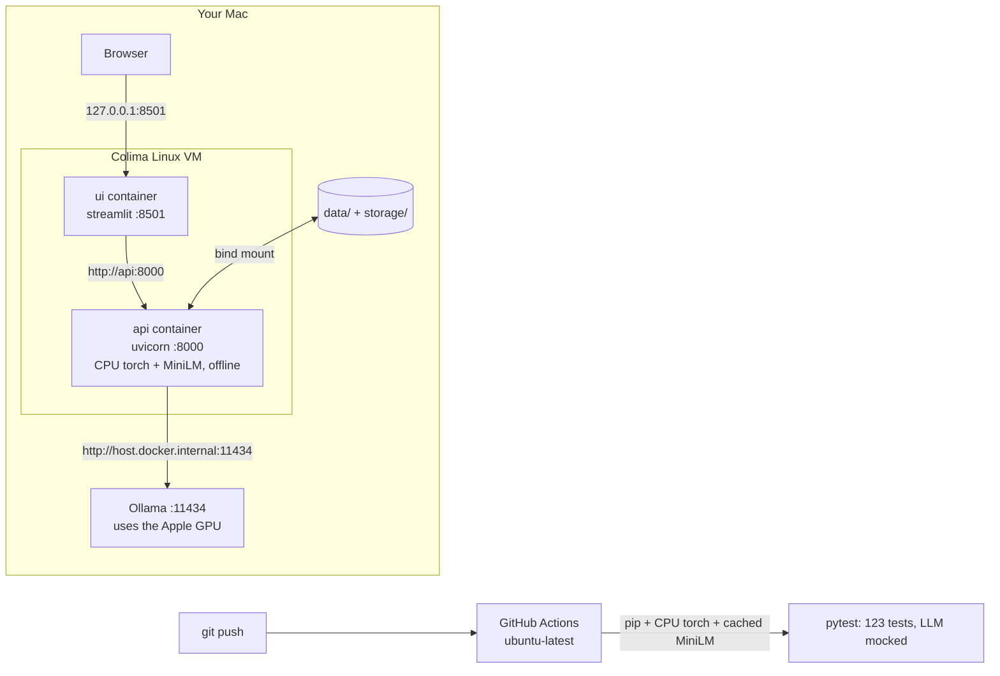

# Phase 10 — Shipping: Docker, CI, README

## 1. What we built and why

A project that only runs on its author's laptop, after twenty manual steps, is hard to
trust and hard to hire for. Phase 10 makes it **reproducible** (Docker images that start
the API and UI with one command), **checked** (GitHub Actions runs all tests on every push)
and **readable** (a README a recruiter can scan in two minutes, a runbook for when things
break, and an MIT licence so others may use the code).

## 2. Explain like I'm five

Shipping is **packing a lunchbox**.
- The **Dockerfile** is the recipe card: start from a plain box (`python:3.11-slim`), add
  exactly these ingredients (pinned packages), label it, close it. Anyone with the card
  makes the same lunch.
- **docker-compose** packs two boxes that go together (API and UI) and says how they talk.
- The **CI** is a teacher who tastes every new lunch before it leaves the kitchen: if a test
  fails, the push gets a red cross.
- The **README** is the menu on the door. The **runbook** is the "what to do if the oven
  smokes" sheet.

## 3. Diagram



## 4. The real concepts

| Term | Plain meaning |
|---|---|
| **Image** | A frozen, layered snapshot of a filesystem plus a start command. Built once from a Dockerfile. |
| **Container** | A running copy of an image, isolated from the host and from other containers. |
| **Layer / cache** | Each Dockerfile instruction makes a layer. Unchanged layers are reused, so put slow, rarely-changing steps (installing packages) before fast-changing ones (copying code). |
| **Multi-stage / build target** | One Dockerfile with named stages (`api`, `ui`); `--target` picks which image to build. |
| **Bind mount (volume)** | A host folder shown inside the container. Our documents and index stay on the Mac. |
| **Port publishing** | `127.0.0.1:8000:8000` exposes a container port on the host's loopback only. |
| **`host.docker.internal`** | A name containers use to reach the host machine (here: Ollama). |
| **Colima** | A free, open-source tool that runs the Linux VM Docker needs on a Mac (instead of Docker Desktop). |
| **CI (Continuous Integration)** | A server that runs your tests automatically on every push. |
| **CPU-only PyTorch** | A PyTorch build without GPU libraries: far smaller, and enough for MiniLM. |
| **MIT licence** | Lets anyone use, copy and change the code if they keep the copyright notice. |

## 5. Code walkthrough

### [Dockerfile](../../Dockerfile) — two images from one recipe

```dockerfile
FROM python:3.11-slim AS base
RUN useradd --create-home --uid 10001 app
```
- Small official base image; a normal user so the app never runs as root.

```dockerfile
FROM base AS api
RUN pip install --index-url https://download.pytorch.org/whl/cpu "torch==${TORCH_VERSION}"
COPY requirements-api.txt .
RUN pip install -r requirements-api.txt
```
- CPU-only PyTorch **first**, from PyTorch's official CPU index. If sentence-transformers
  installed torch itself, pip would pick the default build with GPU libraries.
- Requirements are copied and installed **before** the code, so editing code doesn't
  re-install every package (layer cache).

```dockerfile
RUN python -c "from sentence_transformers import SentenceTransformer; SentenceTransformer('sentence-transformers/all-MiniLM-L6-v2')"
ENV HF_HUB_OFFLINE=1
```
- MiniLM is downloaded at build time; at run time downloads are forbidden. The container
  works with no internet, which matches "private and local".

```dockerfile
FROM base AS ui
COPY requirements-ui.txt .
RUN pip install -r requirements-ui.txt
CMD ["streamlit", "run", "ui/streamlit_app.py", "--server.address=0.0.0.0", ...]
```
- The UI never imports `app/` (a test enforces it), so its image skips PyTorch entirely.
- Inside a container the server must listen on `0.0.0.0`; compose publishes it on 127.0.0.1 only.

### [docker-compose.yml](../../docker-compose.yml) — how the two run together

```yaml
environment:
  OLLAMA_URL: http://host.docker.internal:11434
extra_hosts:
  - "host.docker.internal:host-gateway"
volumes:
  - ./data:/app/data
  - ./storage:/app/storage
ports:
  - "127.0.0.1:8000:8000"
```
- Ollama stays on the Mac: Docker's Linux VM cannot use the Apple GPU.
- Documents and index are mounted, never baked into an image.
- `depends_on: condition: service_healthy` starts the UI only after the API's `/health` answers.

### [requirements*.txt](../../requirements.txt)
`requirements.txt` = `-r requirements-api.txt` + `-r requirements-ui.txt` + pytest. Local
setup is unchanged; each image installs only its half.

### [.github/workflows/ci.yml](../../.github/workflows/ci.yml)
```yaml
- name: Install CPU-only PyTorch
  run: pip install --index-url https://download.pytorch.org/whl/cpu torch==2.14.1
- uses: actions/cache@v4
  with:
    path: ~/.cache/huggingface
- run: python -m pytest -q
```
- `permissions: contents: read`: the workflow can't change the repo.
- No Ollama: every LLM call in tests is a `FakeLLMClient`.

### [README.md](../../README.md), [docs/RUNBOOK.md](../RUNBOOK.md), [LICENSE](../../LICENSE)
README: pitch, architecture, quickstart (local + Docker), real example, real evaluation
tables, trade-offs, security, limitations. Runbook: setup, rebuild, Docker, and a
troubleshooting table of errors actually hit in this project.

## 6. How to run and see it work

```bash
ollama serve                                     # on the Mac, stays bound to 127.0.0.1
colima start --cpu 2 --memory 3 --disk 20        # once per boot
docker-compose up --build
```
Open `http://localhost:8501`.

Real check (2026-10-27, Colima VM 2 CPU / 3 GB / 20 GB disk, Docker 29.5.2, M1 8 GB):

| Check | Real result |
|---|---|
| `docker-compose up --build -d` (images already built, every layer cached) | exit 0 in 2 s; API container `healthy` |
| Image sizes (`docker images`) | `ai-knowledge-assistant-api` 2.1 GB (CPU-only torch + MiniLM), `ai-knowledge-assistant-ui` 827 MB |
| Who listens on 8000 / 8501 on the Mac | Colima's SSH tunnel, on `127.0.0.1` only |
| User inside both containers (`docker exec … id`) | `uid=10001(app)`, not root |
| Files in the API image | `app/`, `scripts/`, `requirements-api.txt` (no `data/`, `storage/`, PDFs or `.env`) |

```
$ curl -s localhost:8000/health
{"status":"ok","index_loaded":true,"chunks":35,"llm_reachable":true,"model":"llama3.2:3b"}
```
`llm_reachable: true` is the important part: the API container reaches Ollama on the Mac through
`host.docker.internal`, although Ollama only listens on `127.0.0.1`.

```
$ POST /ask {"question":"How do I declare a path parameter with a type?"}
HTTP 200 in 9.5 s
answer: You can declare the type of a path parameter in the function, using standard Python
        type annotations: [fastapi-path-params.pdf, p. 2].
invalid_citations: ['[fastapi-path-params.pdf, p. 2]']
timings_ms: retrieve 1083.0, generate 8379.3, total 9467.6   (first question after start)

$ POST /ask {"question":"What is the capital of France?"}
HTTP 200 in 0.08 s — abstained, generate 0.0 ms, total 70.6 ms
```
Same answers as the non-Docker app, including the known wrong p. 2 citation (see Phase 9).

In the browser, the containerised UI showed "API, index and LLM ready" and answered
"Which library performs the data validation in FastAPI?" with "Pydantic", plus the yellow
warning for its p. 4 citation (p. 4 wasn't retrieved): retrieve 77 ms, generate 3606 ms, total 3685 ms.

**CI** can only be proven on GitHub: the workflow file parses (1 job, 6 steps) and the same
`python -m pytest -q` passes locally (123 tests). The first green run on GitHub is still to be checked
after pushing.

## 7. Common errors

| What you see | Why | Fix |
|---|---|---|
| `docker: unknown command: docker compose` (**hit in this phase**) | Homebrew installs Compose as a separate `docker-compose` binary | Use `docker-compose`, or add it as a plugin in `~/.docker/config.json` |
| `colima start` takes many minutes the first time (**hit in this phase**) | It downloads a Linux VM image (~0.5 GB here at ~300 KB/s) | Wait; later starts are fast |
| Low disk space before building (**hit in this phase**: 7.5–10 GB free) | Images with PyTorch are large | CPU-only torch, a UI image without torch, and `docker image prune` |
| API container can't reach Ollama | Ollama not running on the host | `ollama serve` on the Mac (no need to expose it on the network) |
| `PermissionError` writing `storage/` in the container | Container user can't write the mounted folder | See RUNBOOK; fix ownership of `storage/` |

## 8. Security and limits

| Risk | What we did | Limitation |
|---|---|---|
| App running as root | `USER app` (uid 10001) in both images | — |
| Private data in images | `.dockerignore` excludes `data/`, `storage/`, `.env`, `.git` | — |
| Exposure on the network | Ports published on `127.0.0.1`; Ollama stays bound to localhost | No authentication |
| Supply chain | Pinned Python packages, pinned torch, official base image, pinned action versions | Actions pinned by tag, not commit SHA |
| CI tampering | `permissions: contents: read` | — |
| Model licences | MiniLM Apache-2.0; Llama 3.2 Community License noted in README | The LLM is downloaded by the user, not shipped |

## 9. Interview questions

1. **Why is Ollama not in the compose file?** Docker on a Mac runs a Linux VM with no access
   to the Apple GPU, so the model would run on CPU, much slower. The API reaches the host's
   Ollama at `host.docker.internal:11434`, and Ollama stays bound to localhost.
2. **How did you keep the image small?** CPU-only PyTorch from the official CPU index, a
   slim base image, no pip cache, a `.dockerignore`, and a separate UI image without PyTorch.
3. **Why bake MiniLM into the image?** So the container runs offline and starts fast, and the
   build is the only moment that touches the internet.
4. **What does your CI do, and what doesn't it test?** It installs pinned deps, caches MiniLM,
   and runs 123 tests on every push. It doesn't test real LLM behaviour (mocked); that is
   what the evaluation is for.
5. **Why order Dockerfile steps the way you did?** Layer caching: packages change rarely, code
   often. Installing first means a code change rebuilds only the last layers.
6. **Why two requirements files?** The UI never imports the RAG code, so it doesn't need
   PyTorch or FAISS. Splitting keeps the UI image light; `requirements.txt` still installs both for local work.
7. **Why MIT?** Short, permissive, standard for portfolio code. Model weights keep their own licences.

## 10. Try it yourself

1. Change one line in `app/api/main.py` and run `docker-compose build api` twice: watch which
   layers are rebuilt and which say `CACHED`.
2. Run `docker image ls` and compare the sizes of the `api` and `ui` images. Why is one so much bigger?
