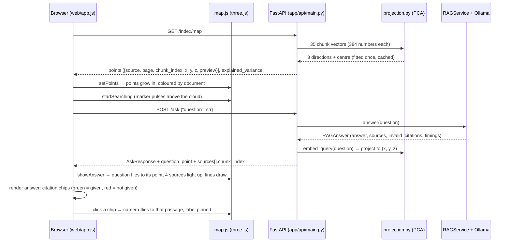

# 3D web app: the knowledge map

## 1. What we built and why

The Streamlit UI worked, but it hid the most interesting part of RAG: *how* the app picks the
passages it answers from. The new web app in [`web/`](../../web/) draws every passage as a point
in 3D, where similar meanings sit close together. When you ask, your question flies in and the
passages it retrieved light up with lines to them. Click any citation and the camera flies to that
passage, including a cited page the model was never given. It is plain HTML/CSS/JavaScript with
three.js, served by the existing FastAPI app, so there is still one address and no build step.

## 2. Explain like I'm five

Imagine a **library where books are shelved by meaning, not by title**. Books about the same
thing sit on the same shelf, even if their titles share no words.
- The map is that library seen from above.
- Your question is a new visitor who walks to the shelf that matches what they mean.
- The four books they pick up glow.
- If the librarian later says "I got this from shelf 2", you can walk to shelf 2 and see it
  wasn't one of the books the visitor picked up.

## 3. Diagram



## 4. The real concepts

| Term | Plain meaning |
|---|---|
| **Embedding** | 384 numbers MiniLM gives each passage. Close numbers = similar meaning. |
| **PCA (principal component analysis)** | Finds the 3 directions along which the 384-number vectors differ most, and measures each passage along them. That gives an (x, y, z) for each passage. |
| **Explained variance** | How much of the differences between passages those 3 directions keep. Here 18.4% + 10.5% + 8.9% ≈ 38%. So the map is a rough picture; search still uses all 384 numbers. |
| **SVD** | The maths numpy uses to do PCA (`np.linalg.svd`). |
| **three.js** | A JavaScript library that draws 3D scenes in the browser with WebGL. |
| **Scene / camera / renderer** | The 3D world, where you look from, and the thing that draws it to the canvas 60 times a second. |
| **OrbitControls** | three.js add-on that lets you drag to rotate and scroll to zoom. |
| **Raycaster** | Shoots a line from the mouse into the scene to find which point you are hovering. |
| **Tween** | Moving something from A to B over time (we use an ease-out curve). |
| **Same origin** | The page and the API share `http://localhost:8000`, so the browser allows the calls without CORS. |
| **CSP (Content-Security-Policy)** | A header that tells the browser which scripts, styles and requests are allowed. Ours: only our own files. |
| **Vendoring** | Copying a library into the repo instead of loading it from the internet, so the app works offline. |

## 5. Code walkthrough

### [app/retrieval/projection.py](../../app/retrieval/projection.py): 384 numbers → 3

```python
mean = vectors.mean(axis=0)
centred = vectors - mean
_u, singular, vt = np.linalg.svd(centred, full_matrices=False)
components[:available] = vt[:available]
```
- Centre the cloud, then SVD. The first rows of `vt` are the directions with the most spread.

```python
if components[i, np.argmax(np.abs(components[i]))] < 0:
    components[i] *= -1
```
- SVD can return a direction or its mirror image. Fixing the sign means the map looks the same every time it is built.

```python
def project(self, vectors):
    return (vectors - self.mean) @ self.components.T / self.scale
```
- The same function places chunks *and* a new question, so the question lands in the right spot.

### [app/api/main.py](../../app/api/main.py): two additions and the web mount

```python
response = AskResponse.model_validate(asdict(result))
projection = state.get_projection()
if projection is not None:
    point = projection.project(embed_query(request.question))[0]
    response.question_point = [round(float(v), 4) for v in point]
```
- New fields only. Old clients (Streamlit, the tests) still work.

```python
app.mount("/", StaticFiles(directory=WEB_DIR, html=True), name="web")
```
- Must come **after** all API routes, or `/` would swallow `/health` and `/ask`. A test checks this.

```python
CONTENT_SECURITY_POLICY = "default-src 'self'; script-src 'self'; style-src 'self'; ..."
```
- Added by a middleware to every response except `/docs` (Swagger loads from a CDN).

### [app/api/dependencies.py](../../app/api/dependencies.py): cached projection
`get_projection()` fits the PCA on first use; `replace_store()` (called by rebuild) clears it, so the map
always matches the current index. `Source.chunk_index` was added in `rag_service.py` so the browser can
match each source to its exact point.

### [web/render.js](../../web/render.js): model text → DOM, safely

```js
if (m[1]) frag.append(onCitation(citationTag(m[1], m[2])));
else if (m[3]) frag.append(el("code", null, m[3]));
```
- One regex walks the text: citations become chip buttons, `` `code` `` becomes `<code>`, everything else is a
  text node. Nothing from the model ever goes through `innerHTML`.
- Images are replaced with "[image removed]" before rendering, as in the Streamlit UI.

### [web/map.js](../../web/map.js): the three.js scene

```js
const target = new THREE.Vector3(p.x, p.y, p.z).multiplyScalar(SPREAD);
this.moveTo(mesh, from, target, 900 + Math.random() * 500);
```
- Each passage is a small sphere. On load (and after a rebuild) it glides from its old place to its new one.

```js
entry.mesh.material.opacity = hit ? 1 : 0.28;
entry.mesh.scale.setScalar(hit ? 1.7 : 1);
```
- After an answer: retrieved passages grow and glow, the rest fade, and lines draw from the question,
  brighter for higher scores.

```js
const distance = radius / Math.tan(Math.min(vertical, horizontal)) + radius * 0.35;
```
- `fitHome()` picks a camera distance so every point fits, whether the panel is a wide desktop
  pane or a short phone strip. The fog moves with it.

```js
if (reduceMotion.matches) { target.copy(to); return; }
```
- With "reduce motion" switched on, everything jumps to its end state and auto-rotate is off.

### [web/app.js](../../web/app.js): wiring
Status pill (words + dot), the ask flow with a real elapsed-seconds timer, answer cards (chips, citation
check, "Passages searched" with score bars), the refusal card ("closest passage scored 0.120…"), error
cards with **Try again**, the Documents `<dialog>` (drag and drop, rebuild), and shortcuts
(Enter, Shift+Enter, `/`).

### [web/vendor/three/](../../web/vendor/three/)
three.js 0.186.1, tarball sha1 checked against npm. One line changed in `OrbitControls.js`
(`from 'three'` → `from './three.module.js'`) so it loads without an inline import map, which the CSP would block.

## 6. How to run and see it work

```bash
ollama serve
uvicorn app.api.main:app --reload        # or: docker-compose up --build
```
Open **http://localhost:8000**.

Real results from 2026-10-27:

| What | Real result |
|---|---|
| `GET /index/map` | 35 points; explained variance 0.1841, 0.1048, 0.0893 |
| "Which tool provides FastAPI's alternative API documentation…" (cold, local) | green `✓ p. 4` chip; retrieve 3851 ms, generate 24265 ms, total 28120 ms. Through Docker later: 14117 ms total |
| "How do I declare a path parameter with a type?" | red `p. 2` chip, "1 of 1 citations failed the check". Clicking it moved the camera from (4.18, 2.6, 5.22) to (1.47, 2.2, 2.1), onto page 2 |
| "What is the capital of France?" | refusal card: "The closest passage scored 0.120, below the threshold, so nothing was sent to the model." |
| Upload invented note + rebuild | "Done: 15 pages/files, 36 passages in 9.61 s"; a new violet point; the answer cited it twice (green). Note deleted afterwards |
| Phone, 375 px | no sideways scroll; every control ≥ 44 px |
| Ollama stopped | status "Ollama offline"; card "The assistant is unavailable" with Try again |

Tests: `python -m pytest -q` → **152 passed** (+8 projection, +9 API: map shape and stability, question point,
rebuild clears the map, page served with CSP, `/docs` not blocked, API routes still win).

## 7. Common errors

| What you see | Why | Fix |
|---|---|---|
| Animation looks frozen in the browser pane (**hit in this phase**) | The pane throttles to ~2 frames/s when it isn't the visible window | Tweens are time-based, so they still finish; check in a normal browser |
| Points off the edge after a rebuild (**hit**) | Fixed camera distance; new PCA axes spread differently | `fitHome()` fits the camera to the points and the panel shape |
| Points dim and grey (**hit**) | Fog tuned for the old camera distance | Fog near/far now follow the camera distance |
| Old label still showing during the next question (**hit**) | Pinned label wasn't cleared | `clearHighlight()` clears it; the camera eases back to the overview |
| "All 1 citations…" (**hit**) | Plural not handled | "The citation points…" for one |
| `THREE.Clock: This module has been deprecated` (**hit**) | three.js r186 deprecates Clock | Use `performance.now()` |
| Blank map, message about WebGL | Browser/GPU without WebGL | Everything else still works; sources are listed as text |
| `/` shows `{"detail":"Not Found"}` | `web/` folder missing (e.g. old Docker image) | Rebuild: `docker-compose up --build` |

## 8. Security and limits

| Risk | What we did | Limitation |
|---|---|---|
| Prompt-injected HTML in answers | Model text only ever becomes text nodes; `innerHTML` only for our own fixed SVG icons | — |
| Data leak through images | Markdown images replaced before rendering | Links still clickable |
| Third-party scripts | CSP `script-src 'self'`; three.js vendored, checksum verified | Vendored code must be updated by hand |
| Reading other files through `/` | Starlette `StaticFiles` stays inside `web/`; 5 traversal probes all returned 404 | — |
| Network exposure | API binds 127.0.0.1; Docker publishes on 127.0.0.1 | No login |
| Misleading picture | The app says the map keeps ≈38% of the variation and that search uses all 384 numbers | Distances on the map are approximate |
| Not verified | Smooth 60 fps motion and the reduced-motion setting couldn't be checked in the throttled pane | Check in Chrome/Safari |

## 9. Interview questions

1. **Why visualise embeddings at all?**
   It makes retrieval explainable: you can see that the question landed near the passages it used, and that a
   wrong citation (p. 2) points to a passage that wasn't retrieved.

2. **How do you get 3D points from 384-dimensional embeddings?**
   PCA with numpy's SVD over the 35 chunk vectors. Same projection for the question. The 3 axes keep about 38%
   of the variation (18.4/10.5/8.9%), which the UI states, so nobody mistakes map distance for the real score.

3. **Why fix the sign of each PCA direction?**
   SVD can return a direction or its mirror. Without fixing it, the map could flip between rebuilds. A test checks it.

4. **How did you add this without breaking existing clients?**
   Only new optional fields (`question_point`, `chunk_index`) and a new endpoint. Streamlit and all 135 earlier tests
   kept working; 17 new tests cover the additions.

5. **How is the frontend kept safe?**
   Strict CSP (only our own files), no inline scripts or styles, model text rendered as text nodes, images stripped,
   three.js vendored with a checked hash.

6. **Why no React or build step?**
   One page, a few components. Plain ES modules load directly in the browser, the API can serve them, and there is
   nothing to compile in Docker. The trade-off is more manual DOM code.

7. **What accessibility work did you do on a 3D UI?**
   Everything on the map is also in text (sources, scores, the citation check). Keyboard: dialog focus trap, Escape,
   `/` shortcut, visible focus rings. Screen readers get answers via a live region. Reduced motion stops animation.

8. **What would you improve?**
   UMAP or t-SNE for a more faithful layout (with care, since they distort distances too), showing the score
   threshold in the scene, and a proper end-to-end browser test in CI.

## 10. Try it yourself

1. Upload two short notes on very different topics, rebuild, and see whether their points land far apart.
2. In `web/map.js`, change `SPREAD` from 2.4 to 1.6 and reload. What happens to the clusters, and does `fitHome()` still keep everything in view?
